### Hashem Sheikhypour
**Web Developer · PHP · Laravel · WordPress · JavaScript**

I build practical web experiences, websites, and tools—with a focus on clear implementation and useful outcomes.

[Portfolio](https://hashemsh.github.io/) · [LinkedIn](https://www.linkedin.com/in/hashemsheikhypour) · [GitHub](https://github.com/hashemsh)

---

## About

I’m a web developer working across backend and frontend development. My core tools are **PHP, Laravel, WordPress, JavaScript, HTML, and CSS**. I also have experience with **Flutter and Dart**, and an interest in technical SEO and digital growth.

This profile highlights selected projects rather than every experiment. For more background and work samples, visit my [personal portfolio](https://hashemsh.github.io/).

## Selected work

### [AI Projects Persian](https://github.com/hashemsh/ai-projects-persian)
A Persian-language collection of practical web tools for content, SEO, campaign links, structured data, and related workflows. The repository includes project-specific documentation and a live showcase.

**[Open the live hub](https://hashemsh.github.io/ai-projects-persian/)** · [Source code](https://github.com/hashemsh/ai-projects-persian)

### [Personal portfolio](https://github.com/hashemsh/hashemsh.github.io)
A bilingual English and Persian portfolio built with HTML, CSS, and JavaScript, with responsive layouts and reduced-motion support.

**[Visit the portfolio](https://hashemsh.github.io/)** · [Source code](https://github.com/hashemsh/hashemsh.github.io)

### [Laravel Persian Validation](https://github.com/hashemsh/laravel-persian-validation)
A Laravel project focused on Persian-language validation messages.

## Technologies

**Core:** PHP · Laravel · WordPress · JavaScript · HTML · CSS · MySQL  
**Also worked with:** Flutter · Dart · Git · Technical SEO

## Get in touch

Have a web project or collaboration in mind? [Connect with me on LinkedIn](https://www.linkedin.com/in/hashemsheikhypour), or explore my [portfolio](https://hashemsh.github.io/) and [repositories](https://github.com/hashemsh?tab=repositories).
