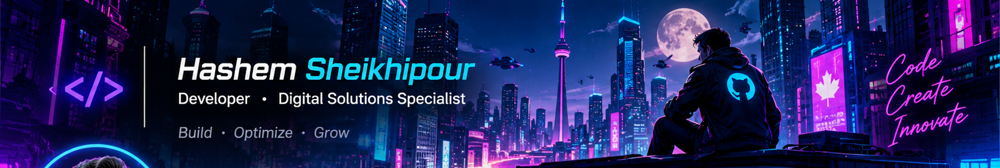

 

  

---

## `> whoami`

I'm **Hashem Sheikhypour** — a web developer and digital solutions specialist interested in building useful web experiences and helping businesses grow online.

- `01` — Web development with **PHP, Laravel and WordPress**
- `02` — Front-end development with **HTML, CSS and JavaScript**
- `03` — Mobile development with **Flutter and Dart**
- `04` — **Technical SEO, Google Ads and digital growth**
- `05` — Building practical tools and experimenting with AI-powered workflows.

## `> tech_stack`

---

## `> featured_project.exe`

### ⚡ AI PROJECTS PERSIAN
#### A growing hub of practical web tools, powered by AI-assisted development.

**One hub. Multiple useful tools. Built for the Persian-speaking web community.**

&nbsp;

  

### What is it?

A collection of lightweight, modular web apps designed to solve practical everyday challenges in content creation, prompt engineering, SEO, campaign tracking and design workflows.

| Tool | What it does |
|:--|:--|
| **Lorem Plus** | Persian placeholder content and SEO-friendly text generation |
| **Prompt+** | AI prompt engineering and optimization |
| **Placeholder Pro** | Generate placeholder images, SVG assets and standard-size visuals |
| **Site Auditor Pro** | Website SEO, performance and accessibility auditing |
| **UTM Builder Pro** | Build and manage campaign tracking links, with GA4-oriented utilities |
| **Schema Generator Pro** | Generate and validate structured data (JSON-LD) |

### Built with a modular mindset

- **AI-assisted development** — using AI as a development partner, with hands-on iteration and refinement.
- **Modular architecture** — independent tools with shared interface components.
- **Lightweight web stack** — designed to run without heavy build tooling.
- **Practical-first approach** — focused on useful workflows, not just demos.
- **Continuous improvement** — new features, refinements and tools are added over time.

**Explore the live hub and try the tools:**

<a href="https://github.com/hashemsh/ai-projects-persian">Source code</a> · <a href="https://hashemsh.github.io/ai-projects-persian/">Live demo</a> · <a href="https://github.com/hashemsh/ai-projects-persian/blob/main/ROADMAP.md">Roadmap</a>

---

## `> connect`

**Have an idea or a project in mind? Let's connect.**

  

<code>BUILD</code> · <code>OPTIMIZE</code> · <code>INNOVATE</code>

